# Bài toán: điểm danh bằng giọng nói trên ESP32-S3

**Tên đề tài:** Hệ thống điểm danh bằng giọng nói trên vi điều khiển ESP32-S3 dùng mô hình nén

**Tên tiếng Anh:** Voice-Based Attendance on the ESP32-S3 Microcontroller with Compressed Speaker Verification Models

## Bối cảnh

Điểm danh bằng cách gọi tên mất vài phút mỗi buổi, ký giấy thì dễ ký hộ. Bài mẫu của môn [17] giải bằng nhận diện khuôn mặt trên Jetson Nano, cần camera, ánh sáng đủ và một máy tính nhúng có GPU. Nhóm làm cùng bài toán đó bằng giọng nói, trên vi điều khiển ESP32-S3: khoảng 200k, 512KB SRAM, CPU 240MHz, thấp hơn Jetson cả một lớp thiết bị. Sinh viên đứng trước thiết bị nói một câu ngắn, thiết bị nhận ra là ai và báo về sổ điểm danh.

Lý do xử lý ngay trên thiết bị: giọng nói là dữ liệu sinh trắc, không nên gửi lên máy chủ; phòng học không phải lúc nào cũng có mạng ổn định; và kết quả phải hiện gần như tức thì để hàng người không bị ùn.

Mô hình xác thực người nói tốt hiện nay (ECAPA-TDNN, khoảng 20 triệu tham số ở bản SpeechBrain) không thể nạp vào vi điều khiển. Nhóm nén xuống khoảng 300KB INT8 và đo xem đổi lại mất bao nhiêu độ chính xác. Trên ESP32-S3, INT8 là bắt buộc chứ không phải tuỳ chọn, vì thư viện tăng tốc ESP-NN chỉ chạy INT8.

## Đầu vào và đầu ra

| | Mô tả |
|---|---|
| Đầu vào | 2–3 giây giọng nói thu qua micro INMP441. Câu gợi ý cố định: "Em tên là [họ tên], có mặt." |
| Đầu ra | Tên và MSSV của người điểm danh, hoặc "không nhận ra, mời nói lại". Kèm giờ điểm danh và điểm tương đồng. |
| Nơi hiển thị | Màn hình OLED trên thiết bị (kèm tiếng bíp), và app sổ điểm danh trên laptop của giảng viên để xem danh sách, xuất CSV. |

Hệ thống có hai chế độ:

- **Nhận diện (1:N), mặc định.** Sinh viên chỉ cần nói. Thiết bị so giọng với tất cả người đã đăng ký trong lớp và chọn người giống nhất.
- **Xác thực (1:1), dự phòng.** Giảng viên nhập MSSV trên app laptop, app gửi lệnh xuống thiết bị, thiết bị chỉ so với mẫu giọng của MSSV đó. Dùng khi chế độ 1:N không chắc chắn sau hai lần nói, hoặc khi lớp quá đông.

## Kiến trúc hệ thống

- **Thiết bị ESP32-S3:** thu âm, lọc khoảng lặng, tính log-mel, chạy model, so khớp, quyết định, hiện kết quả lên OLED. Mẫu giọng cả lớp lưu trong flash của thiết bị.
- **App sổ điểm danh trên laptop (Python):** nhận kết quả từ thiết bị qua USB hoặc WiFi nội bộ, lưu sổ, chặn ghi trùng, điều khiển đăng ký giọng, chế độ 1:1, xuất CSV.
- **Nếu còn thời gian:** chuyển sổ điểm danh thành trang web chạy ngay trên ESP32-S3 để bỏ laptop.

Tách như vậy để firmware chỉ lo phần xử lý giọng nói, còn phần giao diện và lưu trữ viết bằng Python cho nhanh.

## Phạm vi

**Trong phạm vi:**

- Một lớp hoặc nhóm tối đa khoảng 40 người, một thiết bị đặt tại lớp, mỗi lượt một người nói.
- Phòng học bình thường, có tiếng ồn nền ở mức vừa phải.
- Xử lý giọng nói hoàn toàn trên ESP32-S3, không cần Internet. Sổ điểm danh trên laptop, nối với thiết bị qua USB hoặc WiFi nội bộ.
- Mô hình student khoảng 300KB INT8, chọn giữa hai cách: chưng cất từ teacher (KD) và train thẳng.
- Đánh giá trên bộ chuẩn VoxCeleb1-O để so được với các bài đã công bố, cộng thử nghiệm thực tế với 15–20 người tự nguyện.

**Ngoài phạm vi:**

- Không chống giả mạo: ghi âm phát lại, giọng giả tạo bằng AI. Nhóm đo mức dễ bị qua mặt bằng ghi âm và báo cáo như một hạn chế, khuyến nghị dùng kèm sự giám sát của giảng viên.
- Không xử lý nhiều người nói cùng lúc. Không nhận dạng nội dung lời nói.
- Không tích hợp vào hệ thống quản lý đào tạo của trường, chỉ xuất CSV.
- Không thay giảng viên ra quyết định cuối cùng. Kết quả có lịch sử và điểm số để kiểm tra lại các trường hợp sát ngưỡng.
- Không dùng cho mục đích an ninh hay kiểm soát ra vào.

## Cách xử lý

### Đăng ký (một lần, đầu khoá)

Giảng viên chọn "đăng ký" và nhập MSSV trên app laptop. Thiết bị thu 3–5 câu, mỗi câu khoảng 3 giây. Mỗi câu đi qua đúng luồng xử lý như khi điểm danh để ra một embedding, rồi lấy trung bình các embedding làm **mẫu giọng** của người đó. Thiết bị kiểm tra chất lượng: câu quá ngắn, hoặc các câu của cùng một người không đủ giống nhau, thì yêu cầu thu lại.

Thiết bị chỉ lưu mẫu giọng (192 số mỗi người) trong flash, không lưu file ghi âm.

### Điểm danh (mỗi lượt)

1. **Thu âm:** INMP441 qua I2S, 16kHz, một kênh. Ghi cả đoạn vào PSRAM (3 giây khoảng 96KB) rồi mới xử lý. Board có 8MB PSRAM nên không cần tính log-mel theo từng khung trong lúc thu, đơn giản hơn nhiều.
2. **Lọc khoảng lặng:** theo năng lượng. Bắt đầu khi phát hiện tiếng nói, dừng khi im lặng khoảng 0,5 giây. Lấy đúng một đoạn có độ dài cố định (2 hoặc 3 giây, chốt trước khi train). Đoạn có tiếng quá ngắn thì mời nói lại.
3. **Đặc trưng:** log-mel 40 dải bằng FFT của ESP-DSP, theo đúng bộ ràng buộc chung ở dưới.
4. **Model INT8:** TFLite Micro với kernel ESP-NN, ra embedding 192 chiều, chuẩn hoá về độ dài 1.
5. **So khớp:** tính cosine giữa embedding và mẫu giọng của từng người trong lớp.
6. **Quyết định:** chấp nhận người có điểm cao nhất (top-1) khi cả hai điều kiện đều đúng:
   - điểm top-1 ≥ ngưỡng τ;
   - điểm top-1 cao hơn top-2 ít nhất một khoảng δ, để tránh nhầm giữa hai người có giọng giống nhau.

   Không đạt thì mời nói lại. Sau hai lần không đạt thì chuyển sang chế độ 1:1 (giảng viên nhập MSSV trên laptop).
7. **Báo kết quả:** hiện tên lên OLED kèm tiếng bíp, gửi MSSV, giờ và điểm số về app laptop. App chỉ ghi mỗi người một lần mỗi buổi.

### Chọn ngưỡng

Ghi nhầm một người vắng thành có mặt tệ hơn nhiều so với bắt một người nói lại (chỉ mất vài giây). Vì vậy ngưỡng τ được chọn sao cho **tỉ lệ nhận nhầm ≤ 1%**, rồi đo tỉ lệ từ chối nhầm tại ngưỡng đó.

τ ban đầu lấy từ tập val tách ra từ VoxCeleb1. Sau khi cả lớp đăng ký xong, hiệu chỉnh lại τ bằng chính các câu đăng ký: các câu khác nhau của cùng một người tạo cặp cùng người, câu của hai người khác nhau tạo cặp khác người. Cách này không cần thu thêm dữ liệu.

Đây là câu hỏi đo lường nhóm giữ lại từ hướng cũ: ngưỡng chọn trong phòng lab lệch bao nhiêu khi lượng tử hoá từ FP32 sang INT8, và khi chuyển từ VoxCeleb sang giọng Việt qua micro rẻ trong phòng học thật. Hiệu chỉnh lại bằng dữ liệu đăng ký bù được bao nhiêu.

## Bộ ràng buộc chung

Cả nhóm thiết kế theo đúng bảng này ngay từ đầu. Đổi bất kỳ dòng nào phải báo cả nhóm, vì model, firmware và bản Python chuẩn phải khớp nhau.

| Hạng mục | Quy định |
|---|---|
| Âm thanh | 16kHz, một kênh, đoạn cố định 2 hoặc 3 giây (chốt một giá trị trước khi train) |
| Log-mel | Cửa sổ 25ms (400 mẫu, đệm số 0 lên 512), bước 10ms, FFT 512, 40 dải mel, lấy log, trừ trung bình theo đoạn |
| Bản chuẩn | Một bản log-mel viết bằng numpy là chuẩn duy nhất. Ma trận mel filterbank xuất từ bản này ra file header C cho firmware dùng |
| Phép toán của student | Conv hoặc depthwise conv, BatchNorm gộp vào conv, ReLU, pooling trung bình (có thể thêm độ lệch chuẩn), fully connected |
| Embedding | 192 chiều, khớp với teacher |
| Ngân sách | ≤ 300KB INT8, ≤ khoảng 50 triệu phép nhân-cộng mỗi lượt, bộ nhớ khi chạy ≤ khoảng 200KB SRAM |
| Lượng tử hoá | INT8 toàn bộ: trọng số (theo từng kênh), dữ liệu qua các lớp, và đầu vào. Dữ liệu hiệu chuẩn lấy từ tập train |
| Quy ước file | `.tflite` INT8. Bố cục tensor vào và ra do Tiến chốt trong tuần đầu |
| Teacher | Chỉ chạy trên PC, dùng đặc trưng riêng của SpeechBrain (80 dải mel). KD chỉ so embedding nên bên student không cần khớp đặc trưng với teacher |

Nếu pooling có độ lệch chuẩn làm bản INT8 lệch nhiều so với FP32 (phép bình phương và khai căn dễ mất chính xác khi lượng tử hoá) thì chuyển sang pooling trung bình.

Bộ ràng buộc này cũng chạy được trên Raspberry Pi Zero 2 W, nên nếu phải chuyển ở mốc 20/10 thì không phải thiết kế lại model.

## Chuẩn bị model (trên PC)

| Bước | Nội dung | Người |
|---|---|---|
| Teacher | ECAPA-TDNN pretrained từ SpeechBrain, tái lập EER trên VoxCeleb1-O làm mốc trên. Tính sẵn embedding teacher cho toàn bộ tập train, lưu ra file | Ấn |
| KD | Student viết bằng Keras, học theo embedding teacher đã lưu, kết hợp loss phân loại người nói | Quang |
| Train thẳng | Cùng kiến trúc student, Keras, train từ đầu bằng AAM-softmax, không dùng teacher | Ấn |
| INT8 | TFLite converter, lượng tử hoá INT8 toàn bộ, dữ liệu hiệu chuẩn lấy từ tập train | Quang |
| Chọn model | So hai student ở cả FP32 và INT8 trên VoxCeleb1-O, model tốt hơn nạp vào ESP32-S3 | Cả nhóm |

Student viết bằng Keras vì Keras sang TFLite là đường ổn định nhất để chạy TFLite Micro, tránh bước PyTorch sang ONNX rồi sang TFLite rất dễ lỗi. Teacher vẫn là PyTorch nhưng chỉ chạy một lần để tính embedding, nên hai bên không phải nói chuyện trực tiếp với nhau.

Đường tỉa kênh của hướng cũ được bỏ, vì rủi ro cao nhất và không cần cho ứng dụng.

## Đánh giá

**Model, trên VoxCeleb1-O:** EER và minDCF của teacher, KD và train thẳng, ở cả FP32 và INT8. Bản INT8 chạy bằng TFLite interpreter trên PC.

**Kiểm tra khớp giữa PC và board:** đưa khoảng 100 file qua cả bản Python lẫn board, so log-mel và embedding. Khớp thì số đo trên PC đại diện được cho board, không cần nạp cả 4.874 file của bộ thử vào board.

**Hệ thống, thử nghiệm thực tế trên board:**

- 15–20 người tự nguyện, có giấy đồng ý. Buổi 1 đăng ký và điểm danh, buổi 2 vào ngày khác điểm danh lại, để thấy giọng thay đổi theo ngày ảnh hưởng thế nào.
- Hai môi trường: phòng yên tĩnh và phòng ồn.
- Đo tỉ lệ nhận đúng, nhận nhầm sang người khác, và từ chối nhầm ở lần nói đầu và sau khi nói lại.
- **Người lạ:** người chưa đăng ký nói thử, đo tỉ lệ bị nhận nhầm thành người trong lớp.
- **Điểm danh hộ:** phát lại câu điểm danh đã ghi âm bằng điện thoại trước thiết bị, đo tỉ lệ bị chấp nhận.
- **Ngưỡng:** FAR và FRR khi dùng ngưỡng lấy từ VoxCeleb, so với ngưỡng đã hiệu chỉnh bằng dữ liệu đăng ký.

**Trên thiết bị:** thời gian mỗi lượt từ lúc nói xong đến lúc có kết quả, tách theo từng bước (log-mel, model, so khớp), báo cáo trung vị và p95. Bộ nhớ khi chạy (SRAM và PSRAM). Năng lượng mỗi lần chạy model, đo qua INA219. Thời gian cả nhóm điểm danh xong.

## Chỉ tiêu tham chiếu

| Chỉ tiêu | Mục tiêu |
|---|---|
| Kích thước model | ≤ 300KB INT8 |
| Bộ nhớ khi chạy | ≤ khoảng 200KB SRAM |
| Thời gian mỗi lượt | ≤ 1 giây từ lúc nói xong |
| Nhận nhầm sang người khác | ≤ 1%, đặt bằng cách chọn ngưỡng |
| Từ chối nhầm | Đo tại ngưỡng trên và báo cáo, không ép số |
| Lớp 40 người | Điểm danh xong trong khoảng 5 phút |

Nếu không đạt thì báo cáo đúng số đo được kèm phân tích, đúng tinh thần đo lường của đồ án.

## Phần cứng

| Linh kiện | Vai trò | Giá ước lượng |
|---|---|---|
| ESP32-S3 N16R8 (WeAct hoặc bản clone tương thích DevKitC-1) | Thiết bị chính, 16MB flash, 8MB PSRAM | 195k–295k |
| INMP441 × 2 | Micro I2S, mua dư một cái phòng hỏng khi hàn | ~50k/cái |
| Màn hình OLED 0,96" (SSD1306, I2C) | Hiện tên ngay trên thiết bị | ~60k |
| Nút nhấn, buzzer | Bắt đầu lượt nói, báo kết quả | ~20k |
| INA219 | Đo năng lượng | ~50k |
| Breadboard, dây cắm, cáp USB-C có truyền dữ liệu | | ~50–90k |

Tổng khoảng 500k. Laptop của nhóm dùng làm máy chạy app sổ điểm danh.

## Mốc chặn 20/10 và phương án dự phòng

Đến hết ngày 20/10 phải có đủ ba thứ:

- board đã về tay;
- micro đọc được tín hiệu (thu được một file wav từ board về laptop);
- một model TFLite bất kỳ chạy được trên board, kể cả model trọng số ngẫu nhiên.

Thiếu một trong ba thì chuyển sang **Raspberry Pi Zero 2 W** ngay, không cố thêm. Chuyển gần như không mất công, vì toàn bộ phần Python (log-mel bản numpy, TFLite interpreter, so khớp, app sổ điểm danh) được làm trên laptop từ đầu để đánh giá. Khi chuyển chỉ cần chép phần đó sang Pi. Phần nghiên cứu (KD, train thẳng, INT8, ngưỡng, thử nghiệm thực tế) giữ nguyên.

## Dữ liệu giọng và quyền riêng tư

Chỉ thu giọng người tự nguyện, có giấy đồng ý ghi rõ mục đích, thời gian lưu và cách xoá. Thiết bị chỉ lưu mẫu giọng, không lưu file ghi âm khi điểm danh. File ghi âm phục vụ đánh giá để ngoài repo, không đẩy lên dịch vụ công khai, và xoá sau khi nộp.

## Phân công và lịch

| Người | Phụ trách |
|---|---|
| Quang | Bản log-mel numpy chuẩn và xuất filterbank sang C, dữ liệu VoxCeleb1 và MUSAN, tập val, student KD bằng Keras, lượng tử hoá INT8, chọn và hiệu chỉnh ngưỡng |
| Tiến | Firmware ESP32-S3: I2S, lọc khoảng lặng, log-mel bằng C, TFLite Micro và ESP-NN, so khớp, OLED, giao tiếp với laptop, quy ước tensor, đo độ trễ, bộ nhớ và năng lượng |
| Ấn | Teacher và tính sẵn embedding teacher, student train thẳng bằng Keras, app sổ điểm danh trên laptop, khung tính metric, quy trình và giấy đồng ý cho thử nghiệm thực tế, gộp kết quả |

| Tuần | Việc chính |
|---|---|
| 12–18/10 | Đặt mua board. Chốt bộ ràng buộc chung. Bản log-mel numpy. Chạy teacher lấy số mốc, tính sẵn embedding teacher. Tiến dựng ESP-IDF, đọc micro |
| 19–25/10 | **Mốc chặn 20/10.** Train KD và train thẳng, lượng tử hoá INT8. Firmware: log-mel bằng C khớp với bản numpy, chạy model tạm. App sổ điểm danh. Tuần này trùng hạn IT3003, chỉ giao việc cơ học |
| 26/10–01/11 | Nạp model thật, ghép hệ thống, kiểm tra khớp PC và board, thử nghiệm thực tế hai buổi, đo độ trễ và năng lượng |
| 02–08/11 | Viết báo cáo, chuẩn bị demo, nộp |
