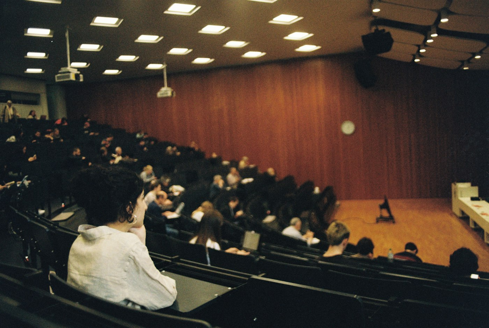
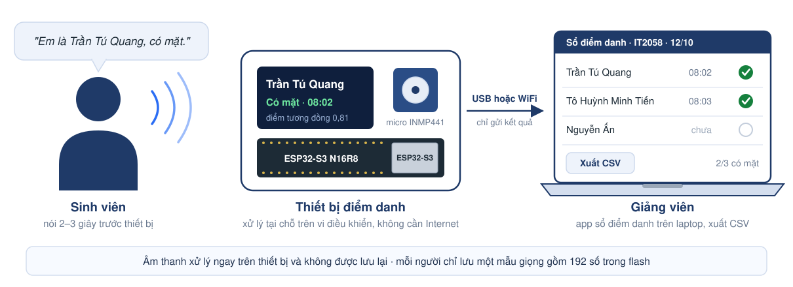
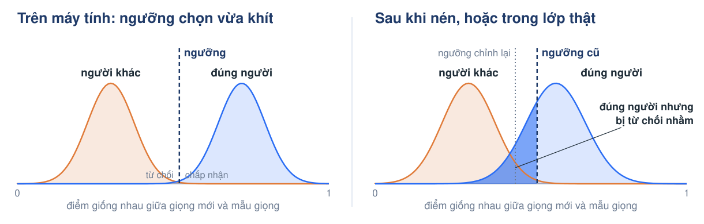
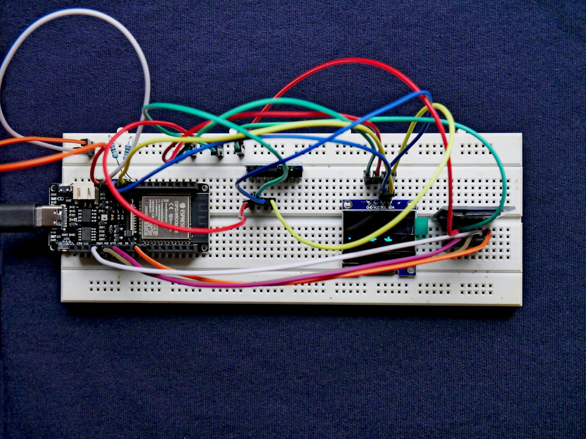

<!-- _class: lead cover -->
<!-- _paginate: false -->

# Hệ thống điểm danh bằng giọng nói trên vi điều khiển ESP32-S3 dùng mô hình nén
### Voice-Based Attendance on the ESP32-S3 Microcontroller with Compressed Speaker Verification Models

**Trần Tú Quang** 250201084 · **Tô Huỳnh Minh Tiến** 250201095 · **Nguyễn Ấn** 250201042

GVHD: ........................

IT2058 · Báo cáo tiến độ đồ án môn học

University of Information Technology, VNU-HCM (UIT) · TP.HCM, 29/09/2026

---

## Nội dung

1. **Bối cảnh và mục tiêu**
2. **Phạm vi bài toán**
3. **Pipeline:** model lớn, model nhỏ, xử lý trên thiết bị
4. **Triển khai và kết quả**
5. **Đánh giá hướng đi**

Ảnh: Henry Storck · Unsplash

---

<!-- footer: 'Nhóm: Quang · Tiến · ẤnPhần 1 · Bối cảnh và mục tiêu29/09/2026' -->
<!-- _class: tight -->

## Bối cảnh và ý tưởng

Ảnh: Vitaly Gariev · Unsplash

- **Hiện nay:** gọi tên mất vài phút mỗi buổi, ký giấy thì dễ ký hộ. Điểm danh bằng khuôn mặt (bài mẫu của môn) cần camera, đủ ánh sáng và máy Jetson Nano có GPU.
- **Ý tưởng:** sinh viên nói một câu ngắn trước một thiết bị nhỏ, thiết bị nhận ra là ai và ghi vào sổ điểm danh.
- **Thiết bị:** vi điều khiển ESP32-S3, rẻ hơn nhiều so với Jetson Nano, rẻ hơn cả Raspberry Pi, tốn ít điện.
- **Xử lý tại chỗ:** giọng nói không rời thiết bị, không cần mạng, có kết quả ngay.

---

<!-- _class: tight -->

## Mục tiêu

Ảnh: Kane Reinholdtsen · Unsplash

1. **Thiết bị điểm danh chạy được trên chip:** nói 2–3 giây, có kết quả trong khoảng 1 giây, ghi vào sổ điểm danh trên laptop.
2. **Model nhận giọng đủ nhỏ để nạp vào chip mà vẫn nhận đúng:** thử hai cách tạo model nhỏ, chọn cách nhận đúng hơn.
3. **Kiểm tra độ tin cậy khi dùng thật:** mức "đủ giống" chọn trên máy tính có còn đúng khi model bị nén và khi dùng trong lớp học thật không.

**Khó khăn chính:** model nhận giọng tốt hiện nay nặng khoảng 80MB, trong khi chip chỉ có 512KB bộ nhớ. Phải làm model nhỏ hơn vài trăm lần.

---

<!-- footer: 'Nhóm: Quang · Tiến · ẤnPhần 2 · Phạm vi29/09/2026' -->

## Bài toán: điểm danh bằng giọng nói

- **Đầu vào:** 2–3 giây giọng nói, câu gợi ý "Em là [họ tên], có mặt." · **Đầu ra:** tên, MSSV, giờ điểm danh, hoặc "không nhận ra, mời nói lại".
- **Cách dùng:** mặc định chỉ cần nói, thiết bị tự so với cả lớp. Nếu không chắc, giảng viên nhập MSSV để thiết bị so riêng với người đó.

---

<!-- _class: tight -->

## Phạm vi bài toán

**Trong phạm vi**
- Lớp hoặc nhóm tối đa khoảng 40 người, một thiết bị đặt tại lớp, mỗi lượt một người nói
- Phòng học bình thường, có ồn nền vừa phải
- Nhận giọng hoàn toàn trên chip; sổ điểm danh trên laptop, xuất được file CSV
- Một model nhỏ khoảng 300KB, chọn từ hai cách tạo model ở phần sau

**Ngoài phạm vi**
- Chống giả mạo (ghi âm phát lại, giọng giả bằng AI): chỉ đo và báo cáo như hạn chế
- Nhiều người nói cùng lúc, nhận dạng nội dung lời nói
- Kết nối với hệ thống quản lý đào tạo của trường
- Dùng cho an ninh hay kiểm soát ra vào

**Nguyên tắc:** kết quả là gợi ý, giảng viên vẫn kiểm tra lại được. Thiết bị chỉ lưu mẫu giọng (192 số mỗi người), không lưu file ghi âm. Chỉ thu giọng người tự nguyện có giấy đồng ý.

---

<!-- footer: 'Nhóm: Quang · Tiến · ẤnPhần 3 · Pipeline29/09/2026' -->
<!-- _class: tight -->

## Model lớn và model nhỏ

<b>Model lớn (teacher)</b> ECAPA-TDNN · khoảng 80MB rất chính xác, chỉ chạy trên máy tính

→

<i style="background:#3d557e"></i><i style="background:#a1afc8"></i><i style="background:#6f82a3"></i><i style="background:#bfcade"></i><i style="background:#29436f"></i><i style="background:#8394b2"></i><i style="background:#5b7094"></i><i style="background:#c9d3e5"></i><i style="background:#8d9db9"></i><i style="background:#475e85"></i><i style="background:#abb8cf"></i><i style="background:#65799b"></i><i style="background:#798baa"></i><i style="background:#b5c1d7"></i><i style="background:#334c76"></i><i style="background:#97a6c0"></i>

dấu vân giọng của teacher

→

↕ so cho giống nhau

<b>Model nhỏ (student)</b> khoảng 300KB, nhỏ hơn vài trăm lần chạy được trên chip ESP32-S3

→

<i style="background:#475e85"></i><i style="background:#97a6c0"></i><i style="background:#798baa"></i><i style="background:#b5c1d7"></i><i style="background:#334c76"></i><i style="background:#8d9db9"></i><i style="background:#51678d"></i><i style="background:#bfcade"></i><i style="background:#8394b2"></i><i style="background:#51678d"></i><i style="background:#a1afc8"></i><i style="background:#6f82a3"></i><i style="background:#8394b2"></i><i style="background:#abb8cf"></i><i style="background:#3d557e"></i><i style="background:#8d9db9"></i>

dấu vân giọng của student

<b style="color:#1F3A68">Cách A · Chưng cất</b> student học bắt chước dấu vân giọng của teacher (mũi tên ↕)

<b style="color:#1F3A68">Cách B · Train thẳng</b> không có teacher, student tự học từ dữ liệu có ghi "giọng này của ai"

Dấu vân giọng (embedding): dãy 192 số tóm tắt đặc điểm giọng. Hai câu của cùng một người cho hai dãy số gần giống nhau.

- **Nén INT8:** lưu mỗi con số trong model bằng 1 byte thay vì 4 byte. Model nhỏ đi 4 lần, chip chạy nhanh hơn, đổi lại điểm số bị xê dịch chút ít.
- **Chọn model:** đo cả hai cách trên bộ dữ liệu chuẩn VoxCeleb1-O, cách nào nhận đúng hơn thì nạp vào chip.

---

<!-- _class: tight -->

## Xử lý trên thiết bị

Đăng ký · một lần đầu khoá

Nói 3–5 câu mỗi câu ~3 giây

→

Bỏ khoảng lặng tính phổ âm thanh

→

Model nhỏ ra dấu vân giọng

→

Lấy trung bình các câu

→

Lưu mẫu giọng vào chip

Điểm danh · mỗi lượt

Nói 2–3 giây

→

Bỏ khoảng lặng tính phổ âm thanh

→

Model nhỏ ra dấu vân giọng

→

So với mẫu giọng cả lớp

→

Đủ giống, bỏ xa người thứ hai?

→

CÓHiện tên, gửi về laptop

KHÔNGMời nói lại

- **Đủ giống:** điểm giống nhau vượt **ngưỡng** (giải thích ở slide sau).
- **Bỏ xa người thứ hai:** tránh nhầm giữa hai bạn có giọng gần giống nhau. Nói lại hai lần vẫn không được thì giảng viên nhập MSSV để so riêng.

---

<!-- _class: tight -->

## Ngưỡng là gì, vì sao có thể lệch

- **Ngưỡng:** điểm giống nhau từ mức này trở lên thì nhận là đúng người. Chọn sao cho gần như không nhận nhầm người khác (≤ 1%).
- **Vì sao lệch:** nén model, micro rẻ và phòng học thật đều làm điểm số xê dịch. Giữ ngưỡng cũ thì nhiều bạn bị từ chối nhầm hơn.
- **Nhóm sẽ đo:** lệch bao nhiêu, và chỉnh lại ngưỡng bằng chính giọng đã đăng ký của lớp có khắc phục được không.

---

<!-- footer: 'Nhóm: Quang · Tiến · ẤnPhần 4 · Triển khai và kết quả29/09/2026' -->
<!-- _class: tight -->

## Phần cứng

| Linh kiện | Vai trò |
|---|---|
| ESP32-S3 N16R8 | Thiết bị chính (16MB flash, 8MB PSRAM) |
| INMP441 | Micro thu âm |
| OLED 0,96" | Màn hình hiện tên |
| Nút, buzzer | Bắt đầu lượt nói, báo kết quả |
| INA219 | Đo điện năng tiêu thụ |

Ảnh minh hoạ: Vishnu Mohanan · Unsplash

| So sánh | Jetson Nano (bài mẫu) | Raspberry Pi | ESP32-S3 (đồ án) |
|---|---|---|---|
| Loại thiết bị | Máy tính nhúng có GPU | Máy tính nhúng | Vi điều khiển |
| Chi phí | Cao | Trung bình | **Thấp nhất** |
| Điện năng | Cao | Trung bình | **Thấp, chạy pin được** |

---

## Kiến trúc phần mềm

**Máy tính · huấn luyện**

- Tính phổ âm thanh (bản chuẩn)
- Chạy model lớn
- Train hai model nhỏ
- Nén INT8, chọn ngưỡng

**ESP32-S3 · chương trình chip**

- Thu âm, bỏ khoảng lặng
- Tính phổ âm thanh
- Chạy model nhỏ, so với mẫu
- Hiện tên, gửi kết quả

**Laptop · sổ điểm danh**

- Nhận kết quả từ thiết bị
- Lưu sổ, chặn ghi trùng
- Đăng ký giọng, nhập MSSV
- Xuất file CSV

Máy tính: file model nhỏ→nạp vào chip ESP32-S3→kết quả điểm danh→laptop

---

<!-- _class: tight -->

## Hiện trạng và kết quả

**Đã xong**
- Chốt bài toán, phạm vi và cách xử lý
- Thiết kế hệ thống, chọn phần cứng
- Kế hoạch đánh giá, repo và tài liệu

**Chưa có**
- Code huấn luyện và chương trình chip
- Số đo thực nghiệm

| Chỉ số | Mục tiêu | Kết quả |
|---|---|---|
| Kích thước model | ≤ 300KB | chờ |
| Thời gian mỗi lượt | ≤ 1 giây | chờ |
| Nhận nhầm người khác | ≤ 1% | chờ |
| Từ chối nhầm | đo, báo cáo | chờ |
| Độ lệch ngưỡng | đo, báo cáo | chờ |
| Điện năng mỗi lượt | đo, báo cáo | chờ |

Báo cáo này **chưa có số liệu thực nghiệm**. Cột "Kết quả" sẽ điền khi có số đo.

---

## Cách đánh giá

**Dữ liệu**
- **VoxCeleb1:** bộ giọng nói công khai, dùng để train và so độ chính xác với các nghiên cứu khác
- **MUSAN:** tiếng ồn nền, để thử độ bền
- **Thực tế:** 15–20 bạn tự nguyện, thu 2 buổi khác ngày, phòng yên tĩnh và phòng ồn

**Đo gì**
- **Model:** tỉ lệ sai trước và sau khi nén
- **Hệ thống:** nhận đúng, nhận nhầm, từ chối nhầm, người lạ, điểm danh hộ bằng ghi âm
- **Thiết bị:** thời gian mỗi lượt, bộ nhớ, điện năng

**Câu hỏi chính:** mức ngưỡng chọn trên máy tính có còn dùng được sau khi nén model, và trong lớp học thật với giọng Việt qua micro rẻ không? Nếu lệch, chỉnh lại bằng giọng đã đăng ký có khắc phục được không?

---

<!-- footer: 'Nhóm: Quang · Tiến · ẤnPhần 5 · Đánh giá hướng đi29/09/2026' -->
<!-- _class: tight -->

## Đánh giá hướng đi

**Điểm mạnh**
- Bài toán thật, cùng bài toán với bài mẫu của môn nhưng trên thiết bị rẻ hơn nhiều
- Giọng nói không rời thiết bị, chạy không cần mạng
- Vẫn có phần nghiên cứu: so hai cách tạo model nhỏ, đo độ tin cậy khi dùng thật

**Hạn chế**
- Model nhỏ kém chính xác hơn model lớn, sẽ có lượt phải nói lại
- Không chống được điểm danh hộ bằng ghi âm
- Thử nghiệm thực tế ít người, chỉ đo trên một thiết bị

**Rủi ro chính:** lập trình chip là phần khó nhất. Nếu không kịp, nhóm chuyển sang Raspberry Pi Zero 2 W mà không phải làm lại model, vì model nhỏ thiết kế cho chip cũng chạy được trên Pi.

---

<!-- footer: 'Nhóm: Quang · Tiến · ẤnĐiểm danh bằng giọng nói trên ESP32-S329/09/2026' -->

## Tài liệu tham khảo

1. Desplanques et al. *ECAPA-TDNN: Emphasized Channel Attention, Propagation and Aggregation in TDNN Based Speaker Verification.* Interspeech 2020.
2. Nagrani et al. *VoxCeleb: A Large-Scale Speaker Identification Dataset.* Interspeech 2017.
3. Snyder et al. *MUSAN: A Music, Speech, and Noise Corpus.* arXiv 2015.
4. Hinton et al. *Distilling the Knowledge in a Neural Network.* 2015.
5. Deng et al. *ArcFace: Additive Angular Margin Loss for Deep Face Recognition.* CVPR 2019.
6. Jacob et al. *Quantization and Training of Neural Networks for Efficient Integer-Arithmetic-Only Inference.* CVPR 2018.
7. Ravanelli et al. *SpeechBrain: A General-Purpose Speech Toolkit.* 2021.
8. Nguyen-Tat, Bui, Ngo. *Automating attendance management in human resources.* IJIM Data Insights, 2024.
9. Nguyen-Tat, Ngo. *Lite-XNet: An efficient deep learning model for COVID-19 lung severity assessment on embedded systems.* CVIU, 2026.
10. David et al. *TensorFlow Lite Micro: Embedded Machine Learning for TinyML Systems.* MLSys 2021.

Ảnh chụp trong slide lấy từ Unsplash (Unsplash License), tên tác giả ghi dưới từng ảnh.

---

<!-- _class: lead -->

# Cảm ơn thầy/cô và các bạn đã lắng nghe

**Trần Tú Quang · Tô Huỳnh Minh Tiến · Nguyễn Ấn**

University of Information Technology, VNU-HCM (UIT)
